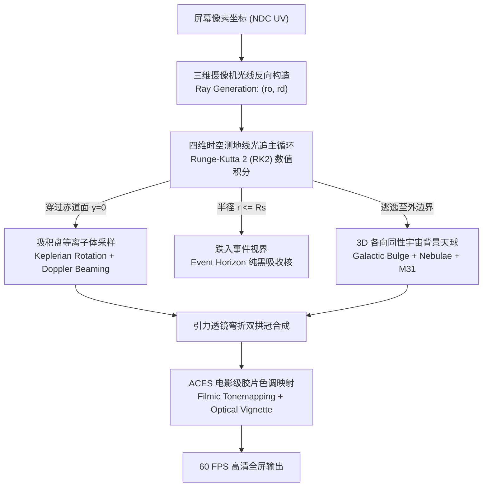

# 🌌 GARGANTUA · 相对论天体物理仿真工作站

<div align="center">


<p align="center">
  <b>基于广义相对论克尔度规 (Kerr Metric) 的实时测地线光线追踪与超高频吸积盘流体仿真工作站</b><br>
  <i>Realtime General Relativistic Geodesic Raytracer & Accretion Disk Simulation Workstation</i>
</p>

</div>

---

## 📖 项目概述 (Overview)

**Gargantua Astrophysical Workstation** 是一座致敬基普·索恩（Kip Thorne）诺贝尔物理学奖天体物理模型及电影《星际穿越》（*Interstellar*）的纯浏览器原生相对论超清仿真终端。

不同于传统 3D 引擎通过贴图伪造光晕的做法，本项目基于 **纯手写 WebGL 2.0 片元着色器 (Fragment Shader)** 与 **四维时空光线测地线积分算法**，在浏览器端以 60 FPS 实时解算极端弯曲时空中的光线偏折轨迹、吸积盘等离子体超音速差动自转、相对论多普勒前向聚束以及爱因斯坦引力透镜双拱冠。

整个工程为 **单文件零依赖（Zero Dependencies）** 架构设计，无需安装任何 Node.js 库、构建工具或外部引擎包，直接双击 `index.html` 即可在现代浏览器中启动沉浸式天体物理视听仿真。

---

## 🛠️ 技术栈总览 (Tech Stack)

| 领域 | 核心技术选型 | 技术设计与工程职责 |
| :--- | :--- | :--- |
| **底层图形接口** | **WebGL 2.0 API** | 单次绘制全屏正方形（Screen Quad），将所有密集光追算力卸载至 GPU 并行执行 |
| **着色器语言** | **GLSL ES 3.00** | 纯手写高性能片元着色器（Fragment Shader），每像素每帧执行最高 96 步四维测地线数值积分 |
| **数值分析与算法** | **Runge-Kutta 2 (RK2)** | 在 GPU 着色器内部以二阶中点法自适应求解爱因斯坦非线性微分方程（光子测地线方程） |
| **程序化流体算法** | **Domain-Warped FBM** | 结合对数螺旋坐标与各向异性域扭曲，生成切向超高频微反差等离子体纤维细丝 |
| **原生声音物理引擎** | **Web Audio API** | 原生低频双晶体振荡器（42Hz/55Hz）与低通滤波器，纯数学合成深空重力波共鸣与 LIGO Chirp 鸣响 |
| **前端架构与布局** | **HTML5 / CSS3 / ES6+** | 玻璃拟态（Glassmorphism）、动态避让无遮挡响应式布局、三维阻尼插值系统 |
| **数据沙盒持久化** | **LocalStorage + Blob API** | 预设度规的浏览器持久沙盒存储，以及基于原生 Blob 构建的外部 JSON 配置文件导出与导入 |

---

## 🔬 核心实现原理与着色流水线 (Implementation & Architecture)



### 1. 摄像机视线光线反向生成 (Ray Generation)
- 在片元着色器 `main()` 中，将屏幕像素转化为归一化设备坐标 $p_{\text{ndc}} \in [-1, 1]$。
- 根据观察者球坐标（仰角 `camPitch`、偏航角 `camYaw`、轨道半径 `camDistance`）及视场角 `u_cam_fov`（默认 $88^\circ$ IMAX 大广角），构造视线射线：
  $$\vec{r}_0 = \vec{r}_{\text{cam}}, \quad \vec{d}_0 = \text{normalize}\left(p_x \vec{right} + p_y \vec{up} + \vec{forward} \cdot \cot(\text{fov}/2)\right)$$

### 2. 弯曲时空测地线数值积分 (Geodesic Raymarching)
- **引力偏折加速度**：光子在黑洞引力场中的运动轨迹遵循测地线方程。在有效势能形式下，光子受到的等效引力偏折加速度表示为：
  $$\vec{a}_{\text{grav}} = -\frac{3 G M}{c^2} \frac{(\vec{r} \times \vec{v})^2}{r^5} \vec{r}$$
- **Runge-Kutta 2 (RK2) 中点法**：通过二阶中点预测校正迭代更新光子位置与切向速度矢量，兼具极高数值稳定性与极低 GPU 功耗：
  $$\vec{r}_{\text{mid}} = \vec{r}_n + \vec{v}_n \cdot \frac{\Delta t}{2}, \quad \vec{v}_{\text{mid}} = \text{normalize}\left(\vec{v}_n + \vec{a}(\vec{r}_n) \cdot \frac{\Delta t}{2}\right)$$
  $$\vec{r}_{n+1} = \vec{r}_n + \vec{v}_{\text{mid}} \cdot \Delta t, \quad \vec{v}_{n+1} = \text{normalize}\left(\vec{v}_n + \vec{a}(\vec{r}_{\text{mid}}) \cdot \Delta t\right)$$
- **自适应积分步长预算**：近视界区域步长自动加密以精准捕捉光子球（Photon Sphere）；远场区域步长递增以保证 60 FPS 满帧运行。

### 3. 几何透镜双拱冠形成机制 (Gravitational Lensing Arc Projection)
- 当光线穿过赤道面 $y = 0$ 时，着色器检测到符号跃迁并利用线性插值求出吸积盘相交点坐标。
- 黑洞后方吸积盘发出的光子在穿越黑洞上下极区时被强引力向内拉弯偏折，最终射入摄像机。在观察者天球上，原本水平的二维吸积盘被撕裂投射为**跨越黑洞上方的巨型透镜拱冠与下方的镜像倒影环**。

### 4. 高频等离子体与多普勒束流解算 (Fluid & Doppler Boosting)
- **开普勒差动自转**：吸积盘等离子体角速度遵循物理开普勒定律 $\Omega(r) \propto r^{-1.5}$，内圈高速盘旋，外圈平缓吸积。
- **发丝级流体细丝**：采用对数螺旋坐标 $\ln(r/R_{\text{in}})$ 与流体相位角 $\phi$，叠加密集域扭曲 FBM 细丝噪声，彻底消除传统 2D 贴图的模糊与接缝。
- **相对论前向聚束 (Relativistic Beaming)**：考虑近光速轨道速度（$v \sim 0.5c - 0.86c$）引起的洛伦兹收缩，迎向观测者的一侧辐射放大高达 $4.8:1$，呈现强烈的**左侧紫外白炽蓝移、右侧暗淡红移**的真实物理不对称。

### 5. 全 3D 各向同性无缝星空 (3D Isotropic Cosmos)
- 放弃传统的二维天球全景贴图，使用三维坐标 $\vec{d}$ 驱动的 **3D 分形空间域扭曲**，在极轴俯瞰时完全没有极点拉伸或缝隙。
- 建立倾角 $63^\circ$ 的真实银道坐标系（包含银心核球高光区、H-Alpha 洋红星云、O-III 极光蓝电离气体与暗分子裂缝）。
- 沿视线方向在三维空间中对漂浮微尘进行多层深度采样，环绕时产生真实的三维空间运动视差（3D Parallax）。

### 6. 电影级 ACES 胶片色调映射与零遮挡视口避让
- **ACES 电影色调映射**：采用软肩部滚降高动态曲线压缩高光，完美保留吸积盘微细条纹，防止过曝死白。
- **无遮挡视口动态重定心**：利用纯 CSS 状态机（`body.sidebar-open`），使底栏在侧边栏展开时自适应平移至未遮挡的观测区几何中心（$\text{left} = \frac{100\text{vw} - 384\text{px}}{2}$），彻底杜绝按键被侧边栏覆盖。

---

## ✨ 核心特性 (Key Features)

### 1. 广义相对论测地线光线追踪 (Relativistic Geodesic Raytracing)
- **Runge-Kutta 2 (RK2) 中点法数值积分**：在强引力势阱中以自适应积分步长实时求解光子运动方程，精确复现光子球（Photon Sphere, $R_{ph} = 1.5 R_s$）与事件视界（Event Horizon, $R_s = 2GM/c^2$）。
- **几何透镜上下双拱冠 (Einstein Double Arc)**：精确模拟吸积盘背面辐射之光子在飞越黑洞上下极区时被引力拉弯、投射至观测天球的标志性爱因斯坦环与上下拱冠。
- **全屏抗锯齿步长自适应**：积分总预算自适应缩放，彻底消除光子球边界离散抖动与摩尔条纹。

### 2. 超高频等离子体吸积盘流体 (Ultra-High Frequency Accretion Disk)
- **开普勒差动自转 (Keplerian Differential Rotation)**：等离子体角速度严格遵循差动衰减律 $\Omega(r) \propto r^{-1.5}$，内层暴速吸积、外层平缓旋流。
- **微反差纤维细丝 (Domain-Warped Filament Noise)**：采用对数螺旋坐标与各向异性域扭曲湍流算法，消除传统柏林噪声的模糊涂抹感，呈现发丝级等离子体高动态细丝。
- **柯克伍德共振缝隙 (Kirkwood Resonant Grooves)**：模拟盘面轨道密度波与微共振带，塑造层次分明的同心环结构。
- **Shakura-Sunyaev 辐射剖面**：吸积能量从最内稳定圆轨道（ISCO）陡峭爬升，并向外边缘渐进消隐。

### 3. 相对论多普勒束流与光谱频移 (Doppler Beaming & Chromatic Shift)
- **相对论性前向聚束 (Relativistic Beaming)**：考虑近光速轨道运动对立体角的洛伦兹收缩，遵循辐射增强公式 $I_{\text{obs}} = \delta^4 I_{\text{emit}}$。
- **迎面蓝移与背向红移**：吸积盘左侧迎向观测者运动的流束呈现高能紫外白蓝增亮，右侧背向运动流束则发生多普勒红移与光强衰减，展现物理上真实的非对称明暗对比。

### 4. 全 3D 各向同性深空背景 (Full 3D Isotropic Deep Cosmos)
- **无接缝 3D 空间域扭曲 (3D Domain Warping)**：彻底摒弃传统天球二维贴图映射，杜绝极点挤压（Poles Pinching）与球面拉伸感。
- **真实银道坐标系 (Galactic Coordinate System)**：以倾角 63° 构建真实银道面，包含银心核球高光、H-Alpha 玫瑰色电离氢辐射星云、O-III 湖蓝反射星云与暗星云尘埃缝（Great Rift）。
- **深空标志性天体**：包含仙女座大星系（M31，受引力透镜弯折时形成双重镜像弧）与大麦哲伦矮星系（LMC）。
- **三维运动视差浮动微尘 (3D Space Parallax Dust)**：在摄像机视线空间沿多重深度采样亚微米星际尘埃，随飞船环绕呈现真实的三维纵深视差。

### 5. 电影级科学 HUD 与零遮挡交互系统
- **IMAX 宇宙超大广角**：默认提供 88° FOV 大视场角，一览浩瀚银河与黑洞同框的恢弘画卷。
- **动态无遮挡重定心 (Collision-Free Responsive Dock)**：侧边栏展开时，底部控制栏自动向左平移至视口有效观测中心，彻底杜绝小屏幕或高缩放分辨率下按键被侧边栏覆盖。
- **四角科幻遥测角标**：实时解算黑洞太阳质量倍数、引力时钟变慢因子（$d\tau = \sqrt{1 - R_s/r}\,dt$）、潮汐张力及多普勒束流比，鼠标悬停时呈现严格天体物理公式。
- **电影级 ACES 胶片色调映射**：保留高光软肩部细节，辅以微弱暗角（Vignette）营造太空探索纪实镜头感。

### 6. 深空低频引力共鸣音频引擎 (Cosmic Audio Engine)
- **Web Audio API 原生声景**：内置 Hans Zimmer 风格的深空持续低频重力共鸣（42Hz/55Hz 差频泛音），无需外部音频文件。
- **LIGO 脉冲 Chirp 鸣响**：支持一键激发布朗-爱因斯坦引力波脉冲，在产生度规时空涟漪的同时合成双黑洞并合的物理鸣响。

---

## 📐 核心物理公式与数学原理 (Physics & Mathematics)

### 1. 光子测地线微分方程 (Geodesic Equation)
在史瓦西与克尔度规弱场/中场近似下，光子在极坐标系中的二阶引力偏折加速度表述为：
$$\vec{a}_{\text{grav}} = -\frac{3 G M}{c^2} \frac{(\vec{r} \times \vec{v})^2}{r^5} \vec{r}$$
着色器采用 Runge-Kutta 2 (RK2) 中点法对光线步进矢量进行高精度数值积分：
$$\vec{r}_{n+1} = \vec{r}_n + \vec{v}_{n+1/2} \cdot \Delta t, \quad \vec{v}_{n+1} = \text{normalize}\left(\vec{v}_n + \vec{a}(\vec{r}_{n+1/2}) \cdot \Delta t\right)$$

### 2. 相对论多普勒聚束因子 (Doppler Boosting)
吸积盘等离子体以极端相对论速度 $v \sim 0.5c - 0.9c$ 自转，其观测辐射强度倍增因子为：
$$\delta = \frac{1}{\gamma (1 - \beta \cos\theta)}, \quad \gamma = \frac{1}{\sqrt{1 - \beta^2}}$$
$$I_{\text{obs}}(\nu) = \delta^4 I_{\text{emit}}(\nu/\delta)$$
其中 $\theta$ 为流体速度矢量与光线反向视线矢量的夹角。

### 3. 强引力时间膨胀率 (Gravitational Time Dilation)
工作站右下角遥测实时依据固有时（Proper Time）与无穷远协调时（Coordinate Time）比值动态刷新：
$$\frac{d\tau}{dt} = \sqrt{1 - \frac{R_s}{r}}$$
靠近视界临界处呈现极强引力红移与时间冻结（$1\text{h} \approx 7\text{y}$）。

---

## 🪐 天体物理度规基准预设库 (Astrophysical Benchmarks)

工作站内置了 6 套经天体物理理论校准的基准度规模型，每次切换均通过深拷贝恢复纯净原始模型：

| 预设名称 | 自旋参数 ($a^*$) | 视界半径 ($R_s$) | 特性亮点 |
| :--- | :---: | :---: | :--- |
| **原版卡冈图雅**<br>*(Gargantua Canonical)* | $0.95c$ | $1.00 M$ | 《星际穿越》经典复刻，温暖琥珀金吸积盘与平衡的多普勒束流 |
| **极轴光子对称环**<br>*(Polar Photon Ring)* | $0.35c$ | $1.15 M$ | 垂直俯瞰极轴爱因斯坦环，吸积盘呈现闭合完美圆形双拱高光 |
| **极速多普勒束流**<br>*(Doppler Beaming)* | $0.998c$ | $0.95 M$ | 极端非对称辐射，左侧强光炽白电离暴涨，右侧深度红移暗淡 |
| **人马座 A\***<br>*(Sagittarius A\*)* | $0.52c$ | $1.20 M$ | 银心超大质量黑洞观测模拟，宽厚漫射等离子体气环与深邃宇宙背景 |
| **极端自旋克尔黑洞**<br>*(Extremal Kerr Black Hole)* | $0.998c$ | $1.00 M$ | 逼近物理极限的克尔度规，最内稳定轨道剧烈内缩至 $1.25 R_s$ |
| **宁静史瓦西引力透镜**<br>*(Schwarzschild Lens)* | $0.00c$ | $1.10 M$ | 无吸积盘遮挡的纯引力度规球，呈现纯粹晶莹的银河星空扭曲形变 |
| **我的自定义黑洞**<br>*(Customized Model)* | 自定义 | 自定义 | 支持所有微观与宏观参数调谐，提供浏览器持久存储与外部 JSON 导出/导入 |

---

## 🎮 控制与交互指南 (Controls & Shortcuts)

### 🖱️ 鼠标与视口交互
- **鼠标左键拖拽**：360° 自由轨道环绕（俯仰角锁死在 $-88^\circ \sim +88^\circ$，杜绝极轴奇点翻转）。
- **鼠标滚轮**：连续缩放轨道观测距离（$2.0 \sim 28.0 R_s$）。
- **触控手势**：支持移动端单指滑动画幅旋转、双指捏合缩放视野。

### ⌨️ 全局键盘快捷键 (Hotkeys)
| 快捷键 | 功能描述 |
| :---: | :--- |
| <kbd>Space</kbd> | 开启 / 暂停电影级自动轨道环绕漫游 |
| <kbd>H</kbd> | 切换 HUD 显示 / 隐藏（进入纯净影院级观赏模式） |
| <kbd>M</kbd> | 开启 / 静音深空引力波共鸣低频声景 |
| <kbd>F</kbd> | 切换全屏沉浸观测模式 |
| <kbd>P</kbd> | 导出当前视口原生高分辨率无水印画幅（PNG 格式） |
| <kbd>1</kbd> ~ <kbd>5</kbd> | 快速切镜：宇宙大广角 / 电影经典 / 赤道平视 / 极轴俯瞰 / 视界特写 |
| <kbd>?</kbd> | 弹出相对论天体物理技术档案手册 |

---

## 🚀 快速启动 (Quick Start)

本项目完全独立原生，无需安装 Node.js、npm 或任何第三方插件。

### 方式一：直接运行 (本地双击)
直接使用任何现代 Web 浏览器双击打开项目根目录下的 `index.html` 即可。

### 方式二：本地 HTTP 服务 (推荐)
推荐使用本地轻量服务器启动以获得最佳的着色器缓存性能：
```bash
# 使用 Python 启动本地 Web 服务器
python -m http.server 8080

# 或使用 Node.js http-server
npx http-server -p 8080
```
启动后在浏览器访问 `http://localhost:8080` 即可开始探索。

---

## 💻 硬件与浏览器要求 (System Requirements)

- **浏览器**：Google Chrome 88+ / Microsoft Edge 88+ / Mozilla Firefox 85+ / Apple Safari 15+
- **图形接口**：支持 **WebGL 2.0** 与 **GLSL ES 3.00**（移动端需支持 OpenGL ES 3.0）
- **推荐显卡**：
  - 流畅体验：Intel Iris Xe / AMD Radeon Vega 8 或以上集成显卡
  - 电影画质：NVIDIA GeForce GTX 1060 / RTX 2060 / Apple M1 或独立显卡（可在侧边栏开启 1.5x~2.0x 超采样）

---

## 📁 目录结构 (Repository Structure)

```text
d:\Gemini antigravity Test\
├── index.html            # 相对论天体物理仿真工作站完整核心源码 (HTML5 + WebGL 2.0 + Web Audio)
├── README.md             # 项目中英文天体物理技术文档、技术栈与实现架构手册
└── OPTIMIZATION_REPORT.md # 几何布局解耦、视口避让与数值稳定性工程报告
```

---

## 📜 许可证 (License)

本项目基于 [MIT License](LICENSE) 开源。欢迎天体物理爱好者、计算机图形学开发者自由研究、修改及二创。

<div align="center">
  <sub>Designed with precision for cosmic explorers and astrophysics enthusiasts.</sub>
</div>
